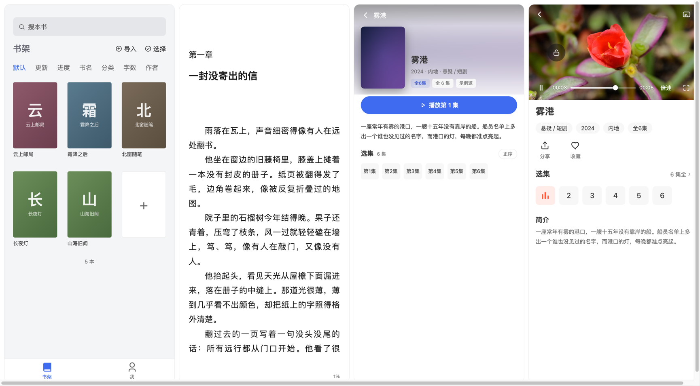

# 微信读书复刻（本地版）

把本地 TXT / EPUB / Markdown 文件导入手机，按微信读书的阅读体验来读：书架、翻页、目录、进度、书签、划线、想法、主题和字体设置。

项目是纯本地应用，没有账号、书城后台、云同步，所有书和阅读数据都保存在设备本地（Android 用 SQLite，浏览器预览用 IndexedDB）。



## 功能

- **本地导入**：`.txt` / `.epub` / `.md`，自动识别 GBK / UTF-8 编码，支持章节切分和 EPUB3 nav / EPUB2 NCX 目录；同一文件重复导入会被识别并跳过。
- **书架**：三列封面网格、7 种排序、搜索、多选、单本删除、重新开始。
- **阅读器**：左右翻页（跟手拖拽）/ 上下滚动、字号 / 边距 / 行距 / 字体 / 主题 / 背景 / 亮度、目录跳章、进度滑块、自动翻页（间隔可调）。
- **阅读统计**：近 30 天每日阅读柱状图、连续阅读天数、本周时长。
- **阅读记录**：按「章节 + 章内字符偏移」保存进度，换字号或重开应用都能回到原文位置。
- **书签 / 划线 / 想法**：长按选词，支持复制、分享、全选、四色划线、写想法、Markdown 导出；同一章不同页可以有多个书签。
- **书内搜索**：在整本书正文里搜一句话，结果按章节列出并直接跳到命中位置。
- **听书**：默认调用设备自带语音引擎逐句朗读（不联网），也可选云端音色；句级跟随高亮、章末自动续播、定时关闭、金句收藏、全屏听书页与底部迷你条。
- **在线书源**（默认关闭）：导入 legado 规则书源，搜索、加入书架、按需抓取章节正文，源站数据不进本地书库以外的任何服务器。
- **备份 / 恢复**：整库导出为 zip（书籍、进度、书签、划线、设置、原始文件），换机或清数据后可一键恢复。
- **个人页**：在读 / 读完 / 笔记 / 书签统计、累计阅读时长、本地占用与配额预警。
- **移动端适配**：Android 返回键、状态栏 / 导航栏安全区、防锁屏 / 横屏 / 音量键翻页、触觉反馈、深色模式、应用内确认弹窗。
- **默认不联网**：所有数据本地存储；网络书源与云端音色都需要用户主动开启。
- **影视**：在「我 → 视频源管理」添加苹果 CMS 视频源后，聚合搜索、详情、多线路剧集与 HLS 播放；源与进度独立存放，不写书库。底部「影视」入口默认隐藏，需在「系统设置 → 显示影视入口」打开。

## 技术栈

- Vue 3 `<script setup>` + TypeScript
- Vite
- Pinia
- Vue Router
- Capacitor 8（Android）
- SQLite（Android，`@capacitor-community/sqlite`）/ IndexedDB（浏览器与测试）
- JSZip（EPUB 解析、备份打包）
- ArtPlayer + hls.js（影视播放）

## 目录

```text
src/
├── views/                 # 书架 / 发现 / 我 / 阅读器 / 目录 / 设置 / 字体选择 / 书源
├── components/            # 图标、TabBar、封面、导入浮层、加载动画、确认弹窗
│   └── reader/            # 阅读器顶栏、底栏、字体 / 主题 / 进度 / 笔记 / 目录 / 听书
├── audio/                 # 听书：分句、播放状态机、设备语音引擎桥
├── utils/                 # 解析、导入、指纹、IndexedDB、进度、划线、备份、原生桥接、弹窗
│   └── source/            # 规则解释器、网络层、四段管线
├── stores/                # Pinia：书籍、章节、书签、阅读设置、应用设置、书源
├── router/                # 路由与 Tab 注册表
├── styles/                # 主题变量与全局移动端样式
├── types/                 # 数据模型
android/                   # Capacitor Android 壳（MainActivity / Gradle / 本地 TTS 插件）
tests/                     # 单元测试 + CDP 浏览器端到端测试
```

## 开发

要求 Node.js 22+。

```bash
npm install
npm run dev
```

浏览器打开 `http://localhost:5173`。

### 构建 Web

```bash
npm run build
npm run preview
```

### 构建 Android APK

```bash
npm run build
./node_modules/.bin/capacitor sync android
cd android
./gradlew assembleDebug
```

产物：`android/app/build/outputs/apk/debug/app-debug.apk`。

Android 构建需要 JDK 21 和本机 Android SDK；SDK 路径写在 `android/local.properties`（该文件不入库）。

## 测试

```bash
npm test          # 23 套单元测试
npm run typecheck # vue-tsc，检查 src 源码
npm run lint      # ESLint（Vue + TypeScript）
npm run test:e2e  # 真实 Chrome 端到端（需要先启动 dev server）
```

`test:e2e` 使用 Chrome DevTools Protocol，在 400×890 / @3x 视口下验证分页、交互、Tab 切换、弹窗和划线链路。

## 数据存储

Android 使用 SQLite（表结构见 `src/utils/storage/sqlite-driver.ts`）；浏览器预览与单测使用 IndexedDB，两者由 `src/utils/db.ts` 统一选驱动，视图与 Pinia store 不感知差异。

首次在 Android 启动时，会在后台把 IndexedDB 的文本数据复制到 SQLite，校验条数通过后打标记，**下一次启动**才切换；失败继续使用 IndexedDB。原始书籍字节仍留在 IndexedDB 的 `files` store，后续再迁到文件系统。

数据库名 `weread`，IndexedDB 当前版本 v6，store：

| store        | 内容                                        |
| ------------ | ------------------------------------------- |
| `books`      | 书籍元数据与最后阅读位置                    |
| `chapters`   | 每章标题、HTML / 纯文本、字数、在线章节地址 |
| `files`      | 导入时的原始字节，供解析器升级后重建        |
| `bookmarks`  | 书签                                        |
| `highlights` | 划线 / 想法字符区间                         |
| `sessions`   | 累计阅读时长                                |
| `settings`   | 阅读设置、应用设置                          |
| `sources`    | 在线书源配置（默认关闭）                    |
| `daily`      | 每天的阅读毫秒数（30 天统计图）             |

进度只存 `(章节索引, 章内字符偏移)`，不存页码，所以换字号、行距、屏幕宽度后仍能恢复。在线书额外记录上次阅读的章节 URL，目录增删后优先按 URL 对回原位置。

启动时会请求 `navigator.storage.persist()`，降低磁盘紧张时数据库被系统回收的概率。设置页的「备份到文件 / 从备份恢复」把上述 store 连同原始字节打包成 zip；恢复是覆盖式的，换机或清数据前请先备份。

## 范围说明

本项目刻意不做：在线书城运营、账号登录、付费会员、云同步、社交关注。底部默认是「书架 / 我」两个入口（「影视」需在系统设置中开启），搜索从书架进入独立页面；书库默认只筛选本地书，影视源需自行添加且与书库数据隔离。听书默认使用设备自带语音引擎，也可选云端音色；在线书源默认关闭，需用户主动开启。

## 说明

这是一个学习性质的开源复刻实现，不包含微信读书的商业代码、字体或内容资源。正文默认使用设备系统字体，所有书籍由用户自行导入。
